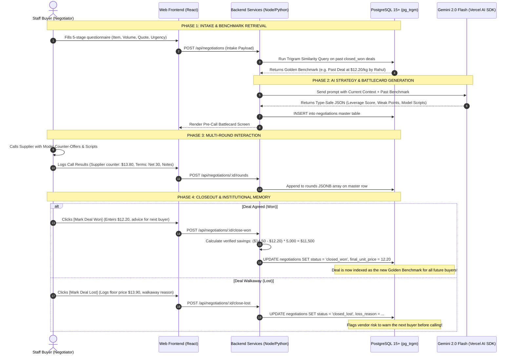

# Bird's-Eye System Architecture Diagram
## ProcureAI: Procurement Negotiation Intelligence & Institutional Memory Platform

This document provides a comprehensive, 30,000-foot macro architectural view of the entire system. It maps all human personas, security gateways, application services, AI orchestration pipelines, database storage structures, and the continuous feedback learning loop.

---

## 1. Master Bird's-Eye System Architecture Diagram

```mermaid
flowchart TD
    %% ==========================================
    %% 1. PERSONAS & ACTORS
    %% ==========================================
    subgraph Personas ["1. Stakeholders & Personas"]
        Admin["Company Admin<br><i>(Executive / VP)</i>"]
        Manager["Procurement Lead<br><i>(Team Manager)</i>"]
        Buyer["Negotiator<br><i>(Staff Buyer)</i>"]
        Viewer["Finance / Auditor<br><i>(Read-Only Viewer)</i>"]
    end

    %% ==========================================
    %% 2. GATEWAY & MULTI-TENANT SECURITY
    %% ==========================================
    subgraph Gateway ["2. Gateway & Multi-Tenant Security Layer"]
        InviteLink["Tokenized Invite Router<br><code>app.com/join?token=...</code>"]
        AuthService["JWT Authentication & Session Guard"]
        TenantGuard["Multi-Tenant Isolation Guard<br><i>(Enforces WHERE org_id = token.org_id)</i>"]
        RBACGuard["Role-Based Access Control (RBAC)<br><i>(Admin | Manager | Negotiator | Viewer)</i>"]
    end

    %% ==========================================
    %% 3. CLIENT INTERFACE (WEB APP)
    %% ==========================================
    subgraph ClientUI ["3. Client Application Layer (React / Next.js)"]
        UI_Intake["5-Stage Intake Wizard<br><i>(Specs, Volume, Targets, Urgency, Vendor)</i>"]
        UI_Battlecard["Pre-Call Battlecard UI<br><i>(Leverage Meter, Weak Points, Scripts)</i>"]
        UI_Rounds["Active Round Logger<br><i>(Price, Terms, Lead Time, Notes)</i>"]
        UI_Closeout["Closeout Modals<br><i>(Won Savings / Lost Floor Price)</i>"]
        UI_Explorer["Savings & Deal Explorer<br><i>(Price Archive & Benchmarks)</i>"]
    end

    %% ==========================================
    %% 4. CORE APPLICATION SERVICES
    %% ==========================================
    subgraph CoreServices ["4. Backend Application Services (Node.js / FastAPI)"]
        Svc_Intake["Intake & Parameter Normalizer"]
        Svc_Match["Historical Deal Matching Engine<br><i>(Trigram Similarity Algorithm)</i>"]
        Svc_AIOrchestrator["AI Strategy Orchestrator<br><i>(Vercel AI SDK + Zod Schema Validation)</i>"]
        Svc_Rounds["Negotiation State Machine<br><i>(Draft -> In_Progress -> Closed)</i>"]
        Svc_Closeout["Closeout & Feedback Engine<br><i>(Automated Savings Calculator)</i>"]
    end

    %% ==========================================
    %% 5. EXTERNAL AI REASONING ENGINE
    %% ==========================================
    subgraph ExternalAI ["5. AI Strategy Engine (Free Tier)"]
        GeminiFlash["Google Gemini 2.0 Flash<br><i>(15 RPM Free Tier • &lt;1.5s Latency)</i>"]
        ZodValidation["Zod Runtime Schema Guard<br><i>(100% Type-Safe Structured JSON)</i>"]
    end

    %% ==========================================
    %% 6. PERSISTENCE & INSTITUTIONAL MEMORY
    %% ==========================================
    subgraph DataStore ["6. Primary Persistence Layer (PostgreSQL 15+)"]
        T_Orgs[("<code>organizations</code><br>Tenants & Settings")]
        T_Users[("<code>users</code><br>Staff Credentials & Roles")]
        T_Invites[("<code>invitations</code><br>Cryptographic Tokens")]
        T_Negos[("<code>negotiations</code> (Master Table)<br>• Direct Intake Columns<br>• rounds JSONB Array<br>• ai_insights JSONB<br>• Outcome & Advice")]
        TrgmIndex[("<code>pg_trgm</code> GIN Index<br><i>Sub-5ms Fuzzy Text Matching</i>")]
    end

    %% ==========================================
    %% RELATIONSHIPS & FLOW CONNECTIONS
    %% ==========================================
    Personas --> InviteLink & AuthService
    InviteLink --> AuthService
    AuthService --> TenantGuard --> RBACGuard
    RBACGuard --> ClientUI

    %% Client to Core Services
    UI_Intake --> Svc_Intake
    UI_Battlecard --> Svc_AIOrchestrator
    UI_Rounds --> Svc_Rounds
    UI_Closeout --> Svc_Closeout
    UI_Explorer --> Svc_Match

    %% Core Services Interconnections
    Svc_Intake --> Svc_Match
    Svc_Match -->|1. Query Past Benchmarks| TrgmIndex
    TrgmIndex -->|Returns Best Past Deal| Svc_Match
    Svc_Match -->|2. Inject Benchmark Context| Svc_AIOrchestrator

    %% AI Pipeline
    Svc_AIOrchestrator <-->|Prompt & Structured Object| ZodValidation
    ZodValidation <--> GeminiFlash

    %% Database Operations
    Svc_Intake -->|Insert Initial Record| T_Negos
    Svc_Rounds -->|Append Round to JSONB| T_Negos
    Svc_Closeout -->|Finalize Won / Lost State| T_Negos
    AuthService --> T_Users & T_Orgs & T_Invites

    %% ==========================================
    %% 7. CONTINUOUS LEARNING FEEDBACK LOOP
    %% ==========================================
    Svc_Closeout -.->|3. Index as New Golden Benchmark| TrgmIndex
    Svc_Closeout -.->|4. Update Vendor Scorecard & Risk| T_Negos
```

---

## 2. End-to-End Operational Lifecycle Flow

This sequence demonstrates how data moves through the architecture during a real negotiation lifecycle:

---

## 3. Architecture Layer Breakdown & Component Responsibilities

| Layer | Primary Components | Key Responsibilities |
|---|---|---|
| **1. Personas** | Admin, Manager, Negotiator, Viewer | Defines the four operational roles across executive management, procurement leads, buyers, and financial auditors. |
| **2. Gateway & Security** | Tokenized Invites, JWT Guard, Tenant Isolation Guard | Enforces strict multi-tenancy. Company A can never access Company B's pricing data. Tokenized invite links eliminate onboarding friction. |
| **3. Client Application** | React / Next.js, Tailwind CSS | Form wizards, streaming battlecard dashboards, interactive round logs, savings calculators, and deal archives. |
| **4. Backend Services** | Node.js / FastAPI REST API | Stateless micro-controllers handling intake normalization, trigram similarity matching, AI prompt construction, and deal lifecycle management. |
| **5. AI Engine** | Google Gemini 2.0 Flash + Vercel AI SDK | Enterprise-grade type-safe LLM integration. Evaluates commercial leverage, identifies psychological weak points, and predicts supplier pushbacks at **\$0.00 launch cost**. |
| **6. Persistence** | PostgreSQL 15+ (`pg_trgm`, JSONB) | Stores all relational metadata, multi-round interaction arrays, and historical pricing benchmarks. Executes sub-5ms fuzzy searches with zero third-party search fees. |
| **7. Feedback Loop** | Automated Savings Calculator & Risk Engine | Closes the learning loop: every won deal becomes the new baseline price; every lost deal captures vendor price resistance. |
