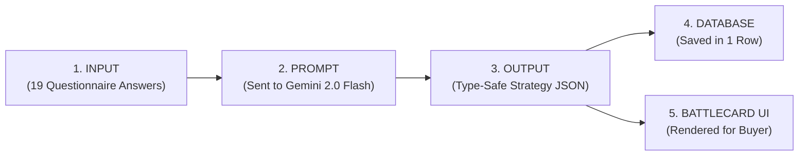

# Negotiation Intake & AI Strategy Engine
## Simple Input-Output Architecture

---

## 1. Simple System Overview

This engine operates as a clean, direct **Input $\rightarrow$ AI $\rightarrow$ Output** model:
- **INPUT:** The buyer submits the 5-stage intake questionnaire (19 parameters).
- **AI PROCESSING:** The backend packages these exact answers into a prompt sent to Google Gemini 2.0 Flash.
- **OUTPUT:** Gemini returns structured pre-call strategy JSON (leverage score, weak points, counter-scripts).
- **PERSISTENCE:** Both the questionnaire inputs and AI insights are saved together in a single row in the `negotiations` table.

> **Note on Removing Extra Pre-Calculations:**  
> Removing the heuristic pre-calculation does **NOT** alter or break the database table or questionnaire. The database stores `buyer_leverage_score INTEGER` and `ai_insights JSONB`. Whether the leverage score is calculated by a hardcoded JavaScript formula or directly by Gemini's reasoning, the database schema and questionnaire remain **100% identical**.

---

## 2. Simple Flowchart



---

## 3. INPUT: The Complete 19 Questionnaire Fields

This JSON payload matches the exact 5-stage questionnaire defined in `procurement_questionnaire.md` and `system_architecture.md`:

```json
{
  // STAGE 1: Item & Specifications
  "item_name": "Cold Rolled Steel Sheet",
  "item_grade_spec": "Grade SS 304",
  "customization_level": "commodity",
  "quality_criticality": "high_precision",

  // STAGE 2: Scale & Quantity
  "quantity": 5000,
  "unit": "kg",
  "purchase_frequency": "quarterly",
  "estimated_annual_volume": 20000,
  "moq_flexibility": "flexible",

  // STAGE 3: Financials & Pricing Boundaries
  "supplier_quote_price": 14.50,
  "target_price": 12.00,
  "walkaway_price": 13.50,
  "currency": "USD",
  "preferred_payment_terms": "net_30",

  // STAGE 4: Urgency & Delivery Logistics
  "required_lead_time_days": 14,
  "urgency_level": "critical",
  "incoterms": "CIF",

  // STAGE 5: Supplier Context & BATNA
  "supplier_name": "Apex Steel Corp",
  "supplier_relationship": "existing_regular",
  "has_alternatives": false,
  "supplier_price_reason": "Nickel prices increased globally"
}
```

---

## 4. THE EXACT PROMPT: Sent to the LLM

The backend dynamically injects the questionnaire values into this clean prompt:

```text
You are an expert manufacturing procurement negotiation director.
Analyze this negotiation context and provide actionable pre-call advice for the buyer.

[STAGE 1: ITEM & SPECIFICATIONS]
- Item: Cold Rolled Steel Sheet (Grade SS 304)
- Customization: Standard Commodity | Quality: High Precision

[STAGE 2: SCALE & VOLUME]
- Order Batch: 5,000 kg (Quarterly Regular)
- Estimated Annual Volume: 20,000 kg | MOQ Flexibility: Flexible

[STAGE 3: COMMERCIAL BOUNDARIES]
- Supplier Initial Quote: $14.50 USD / kg
- Buyer Target Price: $12.00 USD / kg
- Walkaway Ceiling Price: $13.50 USD / kg
- Preferred Payment Terms: Net 30 Days

[STAGE 4: URGENCY & DELIVERY]
- Lead Time Needed: 14 Days | Delivery Terms: CIF
- Urgency Level: Critical (Factory production line stoppage risk)

[STAGE 5: SUPPLIER & MARKET CONTEXT]
- Supplier: Apex Steel Corp (Existing Regular Supplier)
- Alternate Backup Quotes Available: None (Single source currently)
- Supplier Stated Price Justification: "Nickel prices increased globally"

[INSTRUCTIONS]
Return STRICT JSON matching this exact structure:
{
  "buyer_leverage_score": <number between 0 and 100>,
  "leverage_summary": "<1-sentence summary of buyer power>",
  "weak_points": [
    "<vulnerability 1 to hide from supplier>",
    "<vulnerability 2 to hide from supplier>"
  ],
  "recommended_opening_offer": <number>,
  "concession_to_trade": "<what commercial term to trade in exchange for a price cut>",
  "predicted_supplier_question": "<what objection the supplier will push back with>",
  "recommended_response_script": "<exact word-for-word response the buyer should reply with>"
}
```

---

## 5. OUTPUT: What the LLM Returns

The LLM returns this pure, structured JSON:

```json
{
  "buyer_leverage_score": 42,
  "leverage_summary": "Moderate-low leverage due to urgent factory deadline and no active backup quotes.",
  "weak_points": [
    "Critical line stoppage urgency gives supplier high pricing power if you show panic. Never reveal your stockout date.",
    "No active backup quotes; do not bluff a walkaway without preparation."
  ],
  "recommended_opening_offer": 11.80,
  "concession_to_trade": "Offer Net 15 days payment terms (faster cash flow) in exchange for dropping unit price to $12.20.",
  "predicted_supplier_question": "Raw nickel prices jumped 8% this month globally, how can we give you $12.00?",
  "recommended_response_script": "Nickel only accounts for 8% of SS 304 alloy composition; an 8% nickel increase impacts production cost by less than 1%. We are ready to commit to quarterly repeat volume if you meet us at $12.20."
}
```

---

## 6. Saving to Database (Single Table, Single Row)

Both the **19 Questionnaire Inputs** and the **AI Outputs** are saved together in one clean `INSERT` into the `negotiations` table:

```sql
INSERT INTO negotiations (
    org_id,
    created_by,
    status,
    -- Stage 1: Item & Specs
    item_name, item_grade_spec, customization_level, quality_criticality,
    -- Stage 2: Scale & Quantity
    quantity, unit, purchase_frequency, estimated_annual_volume, moq_flexibility,
    -- Stage 3: Financials
    supplier_quote_price, target_price, walkaway_price, currency, preferred_payment_terms,
    -- Stage 4: Urgency & Delivery
    required_lead_time_days, urgency_level, incoterms,
    -- Stage 5: Supplier & BATNA
    supplier_name, supplier_relationship, has_alternatives, supplier_price_reason,
    -- AI Generated Outputs
    buyer_leverage_score,
    ai_insights
) VALUES (
    :org_id,
    :user_id,
    'in_progress',
    'Cold Rolled Steel Sheet', 'Grade SS 304', 'commodity', 'high_precision',
    5000, 'kg', 'quarterly', 20000, 'flexible',
    14.50, 12.00, 13.50, 'USD', 'net_30',
    14, 'critical', 'CIF',
    'Apex Steel Corp', 'existing_regular', FALSE, 'Nickel prices increased globally',
    42,
    :ai_output_json
);
```

---

## 7. What the Buyer Sees on Screen

```text
┌────────────────────────────────────────────────────────────────────────┐
│  🎯 PRE-CALL NEGOTIATION BATTLECARD                                    │
│  Item: Cold Rolled Steel Sheet (Grade SS 304)                          │
├────────────────────────────────────────────────────────────────────────┤
│  🏢 Supplier: Apex Steel Corp    │  📦 Batch: 5,000 kg (Quarterly)     │
│  💰 Quote: $14.50/kg             │  🎯 Target: $12.00/kg (Ceiling: $13.50)│
├────────────────────────────────────────────────────────────────────────┤
│  📊 BUYER LEVERAGE:  42 / 100 (Moderate-Low)                           │
│  Summary: Urgency limits walkaway power; trade payment terms for price.│
├────────────────────────────────────────────────────────────────────────┤
│  ⚠️ WEAK POINTS TO HIDE ON CALL:                                       │
│  • Never mention your factory line stoppage deadline.                 │
│  • Do not bluff having backup quotes if you don't have them.          │
├────────────────────────────────────────────────────────────────────────┤
│  🎯 RECOMMENDED OPENING MOVE:                                          │
│  • Counter-Offer at: $11.80 / kg                                       │
│  • Concession Trade: Offer Net 15 days payment for a $1.20/kg discount.│
├────────────────────────────────────────────────────────────────────────┤
│  🗣️ PREDICTED SUPPLIER EXCUSE & WHAT TO REPLY:                         │
│  Supplier: "Nickel prices jumped 8% this month, we cannot give $12.00" │
│  YOUR REPLY SCRIPT:                                                    │
│  "Nickel is only 8% of SS 304 composition, which is under 1% cost.    │
│   We can commit to quarterly repeat volume if you meet us at $12.20." │
├────────────────────────────────────────────────────────────────────────┤
│  [ 📞 Call Supplier & Log Round 1 ]                                    │
└────────────────────────────────────────────────────────────────────────┘
```
