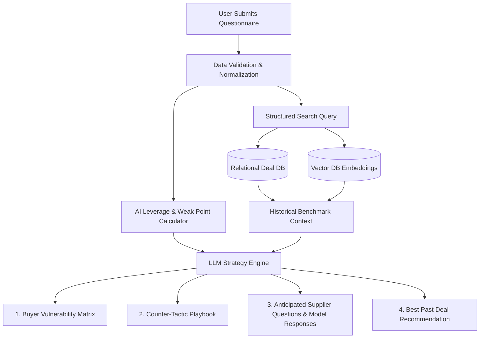

# Manufacturing Procurement Negotiation Questionnaire Specification

This document defines the structured intake questionnaire for the Negotiation Recording & Intelligence Tool. It is designed to capture all essential technical, commercial, and operational parameters required by the AI Strategy Engine to identify buyer leverage, detect vulnerabilities, predict supplier tactics, and retrieve historical deal benchmarks.

---

## Stage 1: Item & Technical Specifications (What are you buying?)

| # | Field Key | Question / Prompt | Field Type | Accepted Values / Format | Why the AI Needs It |
|---|---|---|---|---|---|
| 1.1 | `item_name` | **Item / Raw Material Name** | Text (String) | e.g., "Cold Rolled Steel Coil", "HDPE Granules", "M8 Hex Bolts" | Primary search and indexing key to match against past company purchases. |
| 1.2 | `tech_spec_grade` | **Industry Standard / Grade / Technical Spec** | Text / Tags | e.g., "Grade SS 304", "ISO 9001", "ASTM A36", "Food Grade" | Prevents comparing low-grade quotes with premium-grade historical deals. |
| 1.3 | `customization_level` | **Is this a Standard Commodity or Custom-Made?** | Single Choice | - `commodity`: Off-the-shelf Commodity - `semi_custom`: Standard with custom modifications - `custom_tooling`: Custom Tooling / Mold / Proprietary | **Weak-Point Indicator:** Custom items imply high supplier lock-in and switching friction; standard commodities grant the buyer more switching power. |
| 1.4 | `quality_criticality` | **Quality Tolerance & Rejection Risk** | Single Choice | - `standard`: Standard Commercial Tolerance - `high_precision`: High-Precision Critical - `zero_defect`: Zero-Defect Required (Aero/Medical/Automotive) | Informs the AI to prepare quality guarantee, warranty, and scrap replacement clauses. |

---

## Stage 2: Quantity & Order Frequency (Volume Leverage)

| # | Field Key | Question / Prompt | Field Type | Accepted Values / Format | Why the AI Needs It |
|---|---|---|---|---|---|
| 2.1 | `order_quantity` | **Order Quantity for this deal** | Number + Unit | e.g., `5000` + `units` / `20` + `metric_tons` | Calculates baseline scale and purchasing volume. |
| 2.2 | `purchase_frequency` | **Purchase Frequency** | Single Choice | - `spot`: One-off Spot Purchase - `monthly`: Monthly Regular - `quarterly`: Quarterly - `annual_contract`: Annual Contract Commitment | **Major Leverage Lever:** If recurring, AI prompts the buyer to negotiate lower unit prices against projected long-term volume. |
| 2.3 | `estimated_annual_volume` | **Estimated Annual Volume (if recurring)** | Number + Unit (Optional) | e.g., `60000` + `units` | Demonstrates the full account value to the supplier during negotiations. |
| 2.4 | `moq_flexibility` | **Minimum Order Quantity (MOQ) Flexibility** | Single Choice | - `flexible`: Flexible if unit price drops significantly - `strict_limit`: Strict limit due to storage/working capital | If flexible, AI suggests offering a larger initial batch in exchange for tiered discounts. |

---

## Stage 3: Financials & Pricing Boundaries (The Numbers)

| # | Field Key | Question / Prompt | Field Type | Accepted Values / Format | Why the AI Needs It |
|---|---|---|---|---|---|
| 3.1 | `supplier_quote_price` | **Supplier's Initial Quoted Price** | Currency + Number | e.g., `USD` `14.50` per unit/kg | The starting anchor point for the negotiation. |
| 3.2 | `target_price` | **Your Target / Ideal Price** | Currency + Number | e.g., `USD` `12.00` per unit/kg | Used to calculate the negotiation gap percentage and concession bands. |
| 3.3 | `walkaway_ceiling_price` | **Your Walkaway / Ceiling Price** | Currency + Number | e.g., `USD` `13.50` per unit/kg | Strict upper boundary. The AI ensures counter-offers never exceed this threshold. |
| 3.4 | `preferred_payment_terms` | **Preferred Payment Terms** | Single Choice | - `advance_100`: 100% Advance - `split_advance`: 50% Advance / 50% on Delivery - `net_30`: Net 30 Days Credit - `net_60`: Net 60 Days Credit - `net_90`: Net 90 Days Credit - `lc`: Letter of Credit (LC) | **Trading Chip:** If the supplier resists price cuts, AI advises offering accelerated payment (e.g., Net 15) in exchange for cash discounts. |

---

## Stage 4: Urgency, Delivery & Logistics (Vulnerability Check)

| # | Field Key | Question / Prompt | Field Type | Accepted Values / Format | Why the AI Needs It |
|---|---|---|---|---|---|
| 4.1 | `required_lead_time_days` | **Required Delivery Date / Lead Time** | Date or Days | e.g., `14` days | Tests operational feasibility and shipping buffer. |
| 4.2 | `urgency_level` | **How urgent is this purchase?** | Single Choice | - `low`: Routine stock replenishment - `moderate`: Buffer inventory running low - `critical`: **Critical - Production Line Stoppage Risk** | **Critical Weak Point:** If critical, the buyer cannot easily walk away. The AI flags urgency as a hidden trap the supplier might exploit to hold firm on price. |
| 4.3 | `incoterms` | **Delivery Incoterms & Freight Responsibility** | Single Choice | - `exw`: Ex-Works (Buyer handles freight) - `fob`: Free on Board - `cif`: Cost, Insurance & Freight - `ddp`: Delivered Duty Paid (Door delivery) | Uncovers hidden freight and customs fees that distort the real landed unit price. |

---

## Stage 5: Supplier Context & Market Alternatives (BATNA Check)

| # | Field Key | Question / Prompt | Field Type | Accepted Values / Format | Why the AI Needs It |
|---|---|---|---|---|---|
| 5.1 | `supplier_name` | **Supplier Name & Country/Location** | Text (String) | e.g., "Apex Steel Corp (India)" | Checks company history, past pricing records, and delivery reliability for this vendor. |
| 5.2 | `supplier_relationship` | **Relationship with this Supplier** | Single Choice | - `new_supplier`: Brand New Supplier - `existing_regular`: Existing Regular Supplier - `sole_certified`: Sole Certified / Qualified Source | Determines negotiation tone (collaborative partnership vs competitive bidding). |
| 5.3 | `batna_alternatives` | **Do you have alternate suppliers available? (BATNA)** | Single Choice | - `multiple_active_quotes`: Yes, 2+ active alternative quotes - `viable_needs_qualification`: Yes, but takes time to qualify - `no_alternatives`: No viable alternatives (Sole source) | **Primary Leverage Driver:** If 0 alternatives, AI recommends value-add and terms trading. If multiple quotes exist, AI recommends competitive price benchmarking. |
| 5.4 | `supplier_price_justification` | **What reason did the supplier give for their price?** | Text / Multi-select | e.g., "Raw material spike", "Energy surcharge", "Low order volume", "Custom specs" | AI generates specific counter-arguments to deconstruct the supplier's rationale. |

---

## AI Downstream Consumption Pipeline

