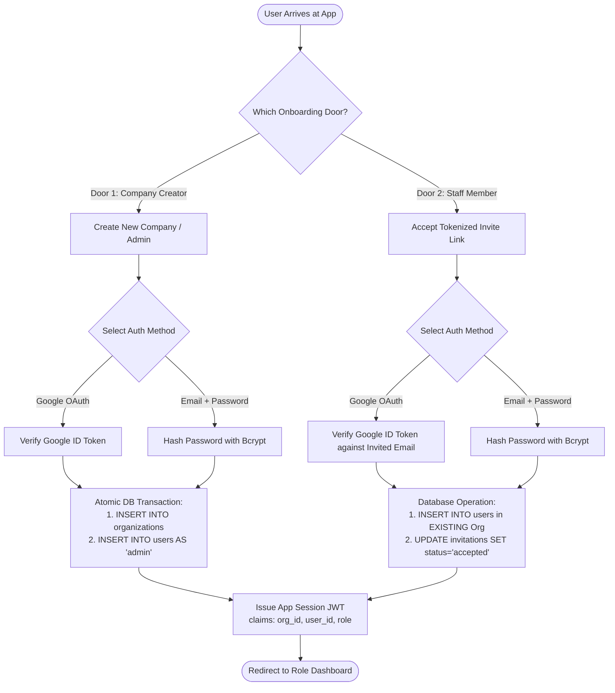
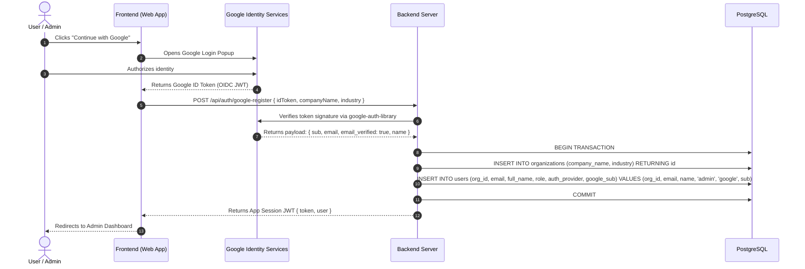
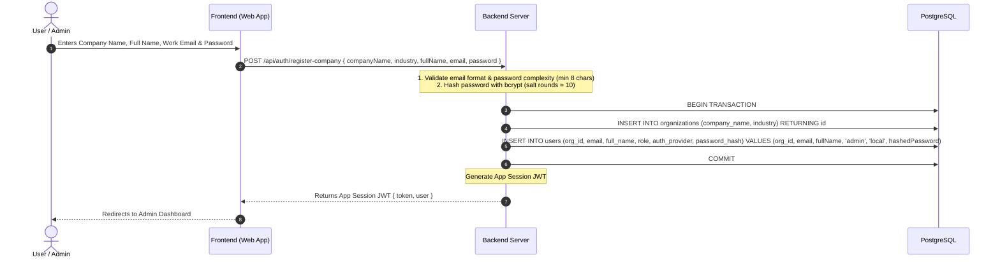

# Topic 6: Registration & Hybrid Authentication Architecture

**Document Version:** 2.0  
**Context:** User Onboarding, Multi-Tenant Provisioning, and Hybrid Identity Federation (Google OAuth 2.0 + Traditional Email/Password)  
**Target Platform:** ProcureAI Platform  

---

## 1. Executive Summary & The Hybrid Strategy

In enterprise manufacturing procurement, relying exclusively on Google Auth creates a critical commercial blocker: **over 70% of manufacturing enterprises run on Microsoft 365 / Azure AD / Outlook**. Corporate buyers with emails like `vikram@tataforge.com` cannot use Google OAuth without linking personal Gmail accounts—a practice strictly forbidden by corporate IT policies.

To ensure **100% addressable market coverage**, ProcureAI adopts a **Hybrid Authentication Architecture**:

```
+-------------------------------------------------------------+
|                  ProcureAI Sign In / Register               |
+-------------------------------------------------------------+
|  [ G  Continue with Google ]        <-- 1-Click Fast        |
+-------------------------------------------------------------+
|                          -- OR --                           |
+-------------------------------------------------------------+
|  Work Email:     [ vikram@precisionforge.com ]              |
|  Password:       [ ************************* ]              |
|                                                             |
|  [ Sign In / Register ]             <-- Universal Access    |
+-------------------------------------------------------------+
```

1. **Google OAuth 2.0 (OIDC):** Frictionless 1-click onboarding for startups, SMBs, and Google Workspace users.
2. **Traditional Email + Password (Bcrypt):** Universal access for any corporate email domain (Microsoft 365, AWS WorkMail, on-premise Exchange, custom ERP domains).

---

## 2. Dual-Door Onboarding Model

Regardless of authentication method (Google or Email/Password), users enter through one of two distinct doors to preserve strict multi-tenant database isolation:



* **Door 1 (Company Creator / Admin):** Creates a brand-new Organization and is assigned `role = 'admin'`.
* **Door 2 (Staff Member / Buyer):** Joins an **existing** Organization via an invite link. **Staff members never create a new company.**

---

## 3. Database Schema Adaptation (Hybrid Support)

To seamlessly accommodate both password-based and federated Google users without redundancy, the `users` table uses a flexible provider column and makes `password_hash` nullable:

```sql
-- Updated Users Table for Hybrid Authentication
CREATE TABLE users (
    id UUID PRIMARY KEY DEFAULT gen_random_uuid(),
    org_id UUID NOT NULL REFERENCES organizations(id) ON DELETE CASCADE,
    email VARCHAR(255) NOT NULL,
    full_name VARCHAR(150) NOT NULL,
    role VARCHAR(50) NOT NULL CHECK (role IN ('admin', 'manager', 'negotiator', 'viewer')),
    
    -- Hybrid Auth Fields
    auth_provider VARCHAR(50) DEFAULT 'local' CHECK (auth_provider IN ('local', 'google', 'microsoft')),
    password_hash VARCHAR(255),               -- Required for 'local', NULL for 'google'
    google_sub VARCHAR(255),                  -- Google's immutable user ID, NULL for 'local'
    
    is_active BOOLEAN DEFAULT TRUE,
    created_at TIMESTAMP WITH TIME ZONE DEFAULT CURRENT_TIMESTAMP,
    updated_at TIMESTAMP WITH TIME ZONE DEFAULT CURRENT_TIMESTAMP,

    -- Multi-tenant scoped uniqueness: allows same email to join/create multiple orgs
    CONSTRAINT unique_user_per_org UNIQUE (org_id, email),

    -- Integrity Check: local users MUST have password_hash; google users MUST have google_sub
    CONSTRAINT check_auth_credentials CHECK (
        (auth_provider = 'local' AND password_hash IS NOT NULL) OR
        (auth_provider = 'google' AND google_sub IS NOT NULL)
    )
);

CREATE INDEX idx_users_org ON users(org_id);
CREATE INDEX idx_users_email ON users(email);
CREATE INDEX idx_users_google_sub ON users(google_sub);
```

---

## 4. End-to-End Authentication Sequences

### 4.1 Method A: Google OAuth 2.0 Flow
Follows the **"Verify First, Persist Second"** principle. The backend cryptographically validates the Google ID Token before executing any database write:



---

### 4.2 Method B: Traditional Email & Password Flow
For enterprise corporate domains (`@company.com`) or users without Google accounts:



---

## 5. Staff Member Future-Proofing: Starting a Company Later

**Scenario:** Rahul (`rahul@precisionforge.com`) is currently a `negotiator` at *Company A*. In the future, Rahul leaves and starts his own company *Company B*.

1. **Scoped Uniqueness:** Because uniqueness is constrained to `UNIQUE (org_id, email)`, the database easily supports Rahul having an account in Company A and another in Company B.
2. **Seamless Login & Org Switcher:**
   * When Rahul logs in (via Password or Google):
     * If associated with **1 company**: Lands straight on the dashboard.
     * If associated with **2+ companies**: A workspace selector modal appears:
       * 🏢 *Precision Forge Ltd* — Role: **Negotiator**
       * 🏢 *Verma Plastics Ltd* — Role: **Admin** (His new venture)
   * The selected `org_id` and corresponding `role` are embedded into the active JWT session.

---

## 6. Backend Implementation Specification (Node.js & Express)

```typescript
import express from 'express';
import bcrypt from 'bcrypt';
import jwt from 'jsonwebtoken';
import { OAuth2Client } from 'google-auth-library';
import { db } from '../db';

const router = express.Router();
const googleClient = new OAuth2Client(process.env.GOOGLE_CLIENT_ID);
const BCRYPT_SALT_ROUNDS = 10;

// ============================================================================
// 1. REGISTER NEW COMPANY - TRADITIONAL EMAIL & PASSWORD
// ============================================================================
router.post('/register-company', async (req, res) => {
  const { companyName, industry, fullName, email, password } = req.body;

  if (!companyName || !fullName || !email || !password) {
    return res.status(400).json({ error: 'All fields are required.' });
  }

  if (password.length < 8) {
    return res.status(400).json({ error: 'Password must be at least 8 characters long.' });
  }

  const client = await db.pool.connect();
  try {
    await client.query('BEGIN');

    // Hash the password securely
    const passwordHash = await bcrypt.hash(password, BCRYPT_SALT_ROUNDS);

    // Create Organization
    const orgRes = await client.query(
      `INSERT INTO organizations (company_name, industry) 
       VALUES ($1, $2) RETURNING id, company_name`,
      [companyName, industry || 'Manufacturing']
    );
    const org = orgRes.rows[0];

    // Create Root Admin User
    const userRes = await client.query(
      `INSERT INTO users (org_id, email, full_name, role, auth_provider, password_hash)
       VALUES ($1, $2, $3, 'admin', 'local', $4)
       RETURNING id, full_name, email, role, org_id`,
      [org.id, email.toLowerCase().trim(), fullName, passwordHash]
    );
    const user = userRes.rows[0];

    await client.query('COMMIT');

    // Issue Signed App Session JWT
    const token = jwt.sign(
      { userId: user.id, orgId: user.org_id, role: user.role, email: user.email },
      process.env.JWT_SECRET,
      { expiresIn: '7d' }
    );

    return res.status(201).json({ token, user });
  } catch (err) {
    await client.query('ROLLBACK');
    console.error('Registration Error:', err);
    return res.status(500).json({ error: 'Failed to create organization.' });
  } finally {
    client.release();
  }
});


// ============================================================================
// 2. REGISTER NEW COMPANY - GOOGLE OAUTH 2.0
// ============================================================================
router.post('/google-register', async (req, res) => {
  const { idToken, companyName, industry } = req.body;

  if (!idToken || !companyName) {
    return res.status(400).json({ error: 'Google ID token and Company Name are required.' });
  }

  try {
    // Verify Google ID Token Signature
    const ticket = await googleClient.verifyIdToken({
      idToken,
      audience: process.env.GOOGLE_CLIENT_ID,
    });
    const payload = ticket.getPayload();

    if (!payload || !payload.email_verified) {
      return res.status(401).json({ error: 'Google email is not verified.' });
    }

    const { email, name, sub: googleSub } = payload;

    const client = await db.pool.connect();
    try {
      await client.query('BEGIN');

      // Create Organization
      const orgRes = await client.query(
        `INSERT INTO organizations (company_name, industry) 
         VALUES ($1, $2) RETURNING id, company_name`,
        [companyName, industry || 'Manufacturing']
      );
      const org = orgRes.rows[0];

      // Create Root Admin User
      const userRes = await client.query(
        `INSERT INTO users (org_id, email, full_name, role, auth_provider, google_sub)
         VALUES ($1, $2, $3, 'admin', 'google', $4)
         RETURNING id, full_name, email, role, org_id`,
        [org.id, email.toLowerCase().trim(), name, googleSub]
      );
      const user = userRes.rows[0];

      await client.query('COMMIT');

      const token = jwt.sign(
        { userId: user.id, orgId: user.org_id, role: user.role, email: user.email },
        process.env.JWT_SECRET,
        { expiresIn: '7d' }
      );

      return res.status(201).json({ token, user });
    } catch (err) {
      await client.query('ROLLBACK');
      throw err;
    } finally {
      client.release();
    }
  } catch (err) {
    console.error('Google Auth Error:', err);
    return res.status(401).json({ error: 'Invalid Google authentication token.' });
  }
});


// ============================================================================
// 3. UNIVERSAL LOGIN - TRADITIONAL EMAIL & PASSWORD
// ============================================================================
router.post('/login', async (req, res) => {
  const { email, password } = req.body;

  if (!email || !password) {
    return res.status(400).json({ error: 'Email and password are required.' });
  }

  try {
    const userRes = await db.query(
      `SELECT id, org_id, email, full_name, role, auth_provider, password_hash, is_active
       FROM users WHERE email = $1`,
      [email.toLowerCase().trim()]
    );

    if (userRes.rows.length === 0) {
      return res.status(401).json({ error: 'Invalid email or password.' });
    }

    const user = userRes.rows[0];

    if (!user.is_active) {
      return res.status(403).json({ error: 'Your account has been deactivated. Please contact your admin.' });
    }

    if (user.auth_provider === 'google') {
      return res.status(400).json({ error: 'This account was created with Google. Please click "Continue with Google".' });
    }

    // Verify Bcrypt Password
    const isValid = await bcrypt.compare(password, user.password_hash);
    if (!isValid) {
      return res.status(401).json({ error: 'Invalid email or password.' });
    }

    const token = jwt.sign(
      { userId: user.id, orgId: user.org_id, role: user.role, email: user.email },
      process.env.JWT_SECRET,
      { expiresIn: '7d' }
    );

    return res.json({
      token,
      user: { id: user.id, org_id: user.org_id, email: user.email, full_name: user.full_name, role: user.role }
    });
  } catch (err) {
    console.error('Login Error:', err);
    return res.status(500).json({ error: 'Internal server error.' });
  }
});

export default router;
```

---

## 7. Edge Cases & Security Handling Matrix

| Edge Case Scenario | Prevention / Mitigation Mechanism | Response Code |
|---|---|---|
| **Brute Force Password Attacks** | Implement `express-rate-limit` (max 5 failed attempts per IP / 15 minutes) | `429 Too Many Requests` |
| **Weak Password Submitted** | Enforce client & server-side validation: minimum 8 characters, at least 1 number & 1 special character | `400 Bad Request` |
| **User registered via Google tries to log in with password** | System detects `auth_provider === 'google'` and prompts: *"This account is linked with Google. Please use Google Sign In."* | `400 Bad Request` |
| **Staff clicks invite link using non-invited Google email** | Backend strictly validates: `payload.email === invitation.email`. Mismatched emails are blocked. | `403 Forbidden` |
| **Mid-registration failure** | Enclosed within PostgreSQL `BEGIN ... COMMIT` block. System rolls back cleanly with zero orphaned rows. | `500 Internal Server Error` |
