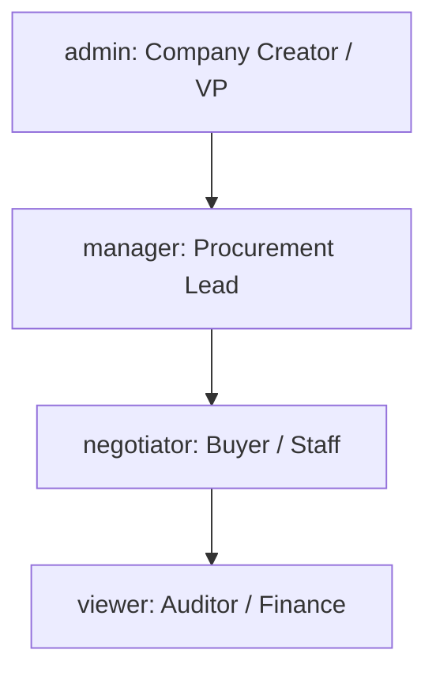
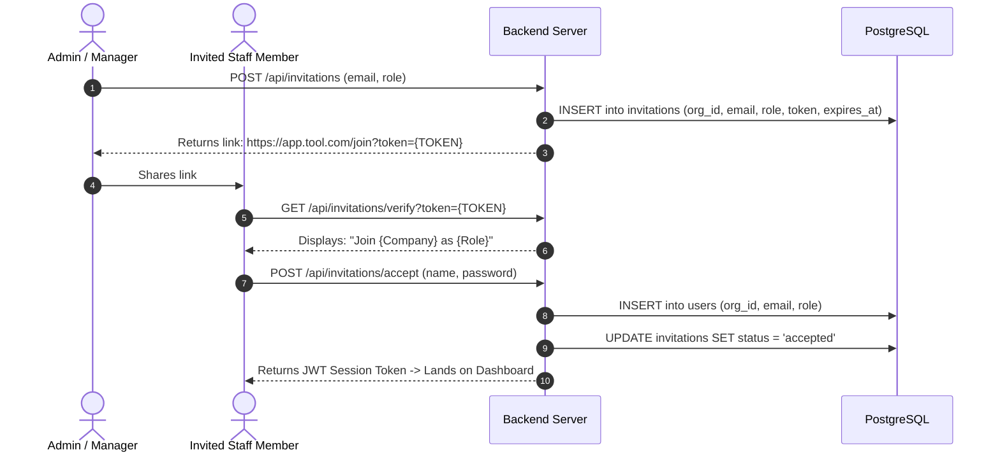
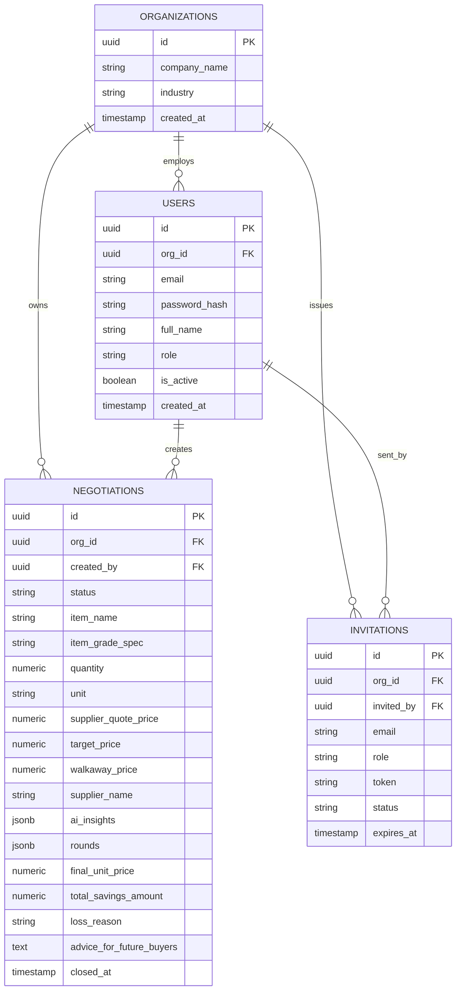

# Master System Architecture Document (SAD)
## AI-Powered Procurement Negotiation & Institutional Memory Platform

**Version:** 1.0  
**Target Domain:** Manufacturing Raw Material Procurement & Supply Chain  
**Status:** Approved Architecture Blueprint  

---

## 1. Executive Summary & Vision

### 1.1 Problem Statement
Manufacturing companies routinely negotiate high-stakes raw material and component contracts. These negotiations suffer from:
1. **Unprepared Buyers:** Buyers enter supplier calls without a quantitative grasp of their leverage, weak points, or counter-tactics.
2. **Institutional Amnesia:** When procurement managers resign or rotate, past negotiation histories, supplier concessions, pricing benchmarks, and negotiation playbooks vanish from the company.
3. **High Onboarding Curve:** New procurement employees have no visibility into historical pricing benchmarks or supplier negotiation tactics.

### 1.2 Solution Overview
A multi-tenant web application that:
- **Guides Pre-Call Preparation:** Takes buyers through a 5-stage manufacturing intake questionnaire.
- **Generates Pre-Call AI Intelligence:** Uses lightweight, zero-cost AI (`gemini-2.0-flash`) to generate buyer leverage scores, identify weak points, and predict supplier objections with model counter-responses.
- **Surfaces Historical Deal Benchmarks:** Uses native PostgreSQL fuzzy matching (`pg_trgm`) to surface past winning deals, best suppliers, and past tactical advice.
- **Closes the Learning Loop:** Logs multi-round negotiations, captures winning tactics or walkaway reasons, and feeds them back into the company’s memory bank.
- **Enforces Multi-Tenant RBAC:** Supports company registration and staff onboarding via secure invite links across 4 distinct roles (`admin`, `manager`, `negotiator`, `viewer`).

---

## 2. High-Level System Architecture Diagram

```mermaid
flowchart TD
    subgraph Client_Layer [Client Layer (Web Application)]
        AdminUI[Admin Dashboard & Staff Management]
        NegotiatorUI[Negotiation Intake & Strategy Dashboard]
        ViewerUI[Price Explorer & Deal Archive]
    end

    subgraph Gateway_Auth [API & Security Layer]
        Router[REST API Router]
        AuthGuard[JWT Auth & RBAC Middleware]
        TenantGuard[Multi-Tenant Org Filter]
    end

    subgraph Service_Layer [Core Business Services]
        SvcAuth[Auth & Invitation Service]
        SvcIntake[Negotiation Intake Service]
        SvcMatch[PostgreSQL Trigram Matching Engine]
        SvcAI[AI Strategy & Prompt Engine]
        SvcClose[Deal Closeout & Analytics Service]
    end

    subgraph External_AI [External AI Engine (Free Tier)]
        Gemini[Google Gemini 2.0 Flash API]
    end

    subgraph Storage_Layer [Data & Persistence Layer]
        PG[(PostgreSQL Database)]
        PG_Trgm[(pg_trgm Text Similarity Index)]
    end

    %% Client to Gateway
    Client_Layer --> Router
    Router --> AuthGuard
    AuthGuard --> TenantGuard

    %% Gateway to Services
    TenantGuard --> SvcAuth & SvcIntake & SvcMatch & SvcAI & SvcClose

    %% Services Interacting
    SvcIntake --> SvcMatch
    SvcMatch --> PG_Trgm
    SvcMatch --> SvcAI
    SvcAI --> Gemini
    SvcAI --> SvcIntake
    SvcIntake --> PG
    SvcClose --> PG
    SvcAuth --> PG
```

---

## 3. Technology Stack & Cost Profile

| Layer | Recommended Technology | Rationale & Cost Profile |
|---|---|---|
| **Frontend** | React / Next.js / Vue + Tailwind CSS | Responsive UI, component-driven form wizards, fast rendering. |
| **Backend** | Node.js (Express / Fastify) or Python (FastAPI) | Lightweight REST API, fast JSON processing, excellent PostgreSQL drivers. |
| **Database** | **PostgreSQL 15+** | Relational integrity, native JSONB support, `pg_trgm` fuzzy matching, zero external search tools needed. **100% Free / Open Source.** |
| **AI Strategy Engine** | **Google Gemini 2.0 Flash via Vercel AI SDK (`ai` + `@ai-sdk/google`)** | Enterprise-grade TypeScript Zod schema enforcement, zero vendor lock-in, **$0.00 Free Tier** (15 RPM). |
| **Authentication** | JWT (JSON Web Tokens) + Bcrypt | Stateless, cryptographically signed, includes `org_id` and `role` in payload. |
| **Hosting Options** | Render, Supabase, Neon, or Docker VPS | Low-cost entry ($0 to $7/month for staging/production database). |

---

## 4. Multi-Tenancy & Role-Based Access Control (RBAC)

### 4.1 The 4 System Roles



1. **`admin`**: Full company administration (manage subscription, invite/remove any user, change roles, inspect all negotiations, delete deals, view company-wide financial savings).
2. **`manager`**: Team management (invite `negotiator` and `viewer` staff, review subordinate negotiation plans, approve ceiling prices, view all company deals).
3. **`negotiator`**: Operational buyer (complete questionnaires, receive AI strategy, log negotiation rounds, mark deals won/lost, query past deal memory).
4. **`viewer`**: Read-only stakeholder (view dashboards, explore historical closed prices and supplier performance, inspect audit trails).

### 4.2 Permissions Matrix

| Capability / Action | `admin` | `manager` | `negotiator` | `viewer` |
|---|:---:|:---:|:---:|:---:|
| Manage Company Profile & Billing | ✅ | ❌ | ❌ | ❌ |
| Invite Staff (`negotiator` / `viewer`) | ✅ | ✅ | ❌ | ❌ |
| Invite Staff (`manager` / `admin`) | ✅ | ❌ | ❌ | ❌ |
| Remove / Deactivate Staff | ✅ | ❌ | ❌ | ❌ |
| Create New Negotiation & Trigger AI | ✅ | ✅ | ✅ | ❌ |
| Log Rounds & Mark Deals Won / Lost | ✅ | ✅ | ✅ | ❌ |
| Search Historical Deal Archive & Benchmarks | ✅ | ✅ | ✅ | ✅ |
| View Company-Wide Financial Savings Metrics | ✅ | ✅ | ✅ *(Full Visibility)* | ✅ |

> **Note on Savings Visibility:** By default, all roles (including `negotiator`) can view company-wide financial savings metrics to encourage team motivation, healthy competition, and cross-material negotiation benchmarking. An admin can optionally toggle this to "Own Deals Only" in Company Settings if executive confidentiality is required.

### 4.3 Invite Link Architecture



---

## 5. Database Schema & Data Architecture (PostgreSQL)

The entire system requires **only 4 primary tables**. By utilizing PostgreSQL’s `JSONB` and array types, we avoid over-normalizing into multiple negotiation tables while maintaining strict relational boundaries.



### Complete DDL Script

```sql
-- 1. Enable Trigram Extension for Fuzzy Matching
CREATE EXTENSION IF NOT EXISTS pg_trgm;

-- 2. Organizations Table
CREATE TABLE organizations (
    id UUID PRIMARY KEY DEFAULT gen_random_uuid(),
    company_name VARCHAR(255) NOT NULL,
    industry VARCHAR(100),
    created_at TIMESTAMP WITH TIME ZONE DEFAULT CURRENT_TIMESTAMP,
    updated_at TIMESTAMP WITH TIME ZONE DEFAULT CURRENT_TIMESTAMP
);

-- 3. Users Table (RBAC)
CREATE TABLE users (
    id UUID PRIMARY KEY DEFAULT gen_random_uuid(),
    org_id UUID NOT NULL REFERENCES organizations(id) ON DELETE CASCADE,
    email VARCHAR(255) UNIQUE NOT NULL,
    password_hash VARCHAR(255) NOT NULL,
    full_name VARCHAR(150) NOT NULL,
    role VARCHAR(50) NOT NULL CHECK (role IN ('admin', 'manager', 'negotiator', 'viewer')),
    is_active BOOLEAN DEFAULT TRUE,
    created_at TIMESTAMP WITH TIME ZONE DEFAULT CURRENT_TIMESTAMP
);
CREATE INDEX idx_users_org ON users(org_id);

-- 4. Invitations Table (Invite Links)
CREATE TABLE invitations (
    id UUID PRIMARY KEY DEFAULT gen_random_uuid(),
    org_id UUID NOT NULL REFERENCES organizations(id) ON DELETE CASCADE,
    invited_by UUID NOT NULL REFERENCES users(id),
    email VARCHAR(255) NOT NULL,
    role VARCHAR(50) NOT NULL CHECK (role IN ('admin', 'manager', 'negotiator', 'viewer')),
    token VARCHAR(255) UNIQUE NOT NULL,
    expires_at TIMESTAMP WITH TIME ZONE NOT NULL,
    status VARCHAR(50) DEFAULT 'pending' CHECK (status IN ('pending', 'accepted', 'revoked')),
    created_at TIMESTAMP WITH TIME ZONE DEFAULT CURRENT_TIMESTAMP
);
CREATE INDEX idx_invitations_token ON invitations(token);

-- 5. Negotiations Master Table (Intake, AI, Rounds, and Outcome in ONE table)
CREATE TABLE negotiations (
    id UUID PRIMARY KEY DEFAULT gen_random_uuid(),
    org_id UUID NOT NULL REFERENCES organizations(id) ON DELETE CASCADE,
    created_by UUID NOT NULL REFERENCES users(id),
    status VARCHAR(50) DEFAULT 'in_progress' CHECK (status IN ('draft', 'in_progress', 'closed_won', 'closed_lost', 'cancelled')),

    -- Intake Fields (User Answers from 5-Stage Questionnaire)
    item_name VARCHAR(255) NOT NULL,
    item_grade_spec VARCHAR(255),
    customization_level VARCHAR(50) DEFAULT 'commodity', -- 'commodity', 'semi_custom', 'custom_tooling'
    quality_criticality VARCHAR(50) DEFAULT 'standard',   -- 'standard', 'high_precision', 'zero_defect'
    quantity NUMERIC(15, 2) NOT NULL,
    unit VARCHAR(50) NOT NULL,
    purchase_frequency VARCHAR(50),                      -- 'spot', 'monthly', 'quarterly', 'annual'
    estimated_annual_volume NUMERIC(15, 2),
    moq_flexibility VARCHAR(50) DEFAULT 'flexible',
    supplier_quote_price NUMERIC(15, 2) NOT NULL,
    target_price NUMERIC(15, 2) NOT NULL,
    walkaway_price NUMERIC(15, 2) NOT NULL,
    currency VARCHAR(10) DEFAULT 'USD',
    preferred_payment_terms VARCHAR(50) DEFAULT 'net_30',
    required_lead_time_days INTEGER,
    urgency_level VARCHAR(50),                           -- 'low', 'moderate', 'critical'
    incoterms VARCHAR(50) DEFAULT 'CIF',
    supplier_name VARCHAR(255) NOT NULL,
    supplier_relationship VARCHAR(50) DEFAULT 'existing_regular',
    has_alternatives BOOLEAN DEFAULT FALSE,
    supplier_price_reason TEXT,

    -- AI Generated Strategy & Weak Points
    buyer_leverage_score INTEGER,                        -- 0 to 100
    ai_insights JSONB,                                   -- { weak_points[], tactics{}, predicted_questions[] }

    -- Negotiation Interaction Rounds (Array of meetings/calls)
    rounds JSONB DEFAULT '[]'::jsonb, -- [{ round: 1, date, offer, counter, notes }]

    -- Deal Closure (Won Flow)
    final_unit_price NUMERIC(15, 2),
    total_savings_amount NUMERIC(15, 2),
    agreed_payment_terms VARCHAR(100),
    agreed_lead_time_days INTEGER,
    supplier_rating NUMERIC(2, 1),
    winning_tactics TEXT[],

    -- Deal Closure (Lost Flow)
    loss_reason VARCHAR(100),         -- 'price_exceeded_walkaway', 'bad_payment_terms', 'unresponsive', etc.
    supplier_lowest_counter_offer NUMERIC(15, 2),
    loss_next_action VARCHAR(100),    -- 'switched_supplier', 'postponed', etc.

    -- Institutional Memory
    advice_for_future_buyers TEXT,    -- Lessons learned for the next employee
    closed_at TIMESTAMP WITH TIME ZONE,
    created_at TIMESTAMP WITH TIME ZONE DEFAULT CURRENT_TIMESTAMP,
    updated_at TIMESTAMP WITH TIME ZONE DEFAULT CURRENT_TIMESTAMP
);

-- Trigram Index for Lightning-Fast Similarity Search (< 5ms)
CREATE INDEX idx_negotiations_org_status ON negotiations(org_id, status);
CREATE INDEX idx_negotiations_item_trgm ON negotiations USING gin (item_name gin_trgm_ops);
CREATE INDEX idx_negotiations_supplier ON negotiations(supplier_name);
```

---

## 6. Historical Deal Matching Engine (PostgreSQL ALONE)

### 6.1 Workflow & Timing
The search executes **immediately after the user submits the questionnaire**. At this stage, the system has the complete context (Item name, Grade spec, Quantity, Current Quote, and Supplier Name).

### 6.2 The Match Query
```sql
SELECT 
    id,
    item_name,
    item_grade_spec,
    supplier_name,
    final_unit_price,
    currency,
    quantity,
    agreed_payment_terms,
    advice_for_future_buyers,
    closed_at,
    similarity(item_name, :input_item_name) AS item_similarity
FROM negotiations
WHERE org_id = :current_user_org_id
  AND status = 'closed_won'
  AND (
      item_grade_spec ILIKE :input_grade_spec
      OR similarity(item_name, :input_item_name) > 0.4
      OR supplier_name ILIKE :input_supplier_name
  )
ORDER BY 
    (supplier_name ILIKE :input_supplier_name) DESC, -- Exact supplier match gets highest priority
    item_similarity DESC,
    closed_at DESC
LIMIT 1;
```

---

## 7. AI Strategy & Weak-Point Engine (Gemini 2.0 Flash)

### 7.1 Backend Prompt Construction
When the questionnaire is submitted and any historical deal benchmark is retrieved, the backend constructs the following prompt for the Gemini API:

```text
You are a senior manufacturing procurement strategist.
Analyze this negotiation context and return STRICT JSON matching the schema below:

[CURRENT NEGOTIATION CONTEXT]
- Item: {{item_name}} (Grade: {{item_grade_spec}}, Custom: {{is_custom}})
- Quantity: {{quantity}} {{unit}} (Frequency: {{purchase_frequency}})
- Supplier Initial Quote: {{currency}} {{supplier_quote_price}}
- Buyer Target Price: {{currency}} {{target_price}} (Ceiling: {{walkaway_price}})
- Urgency: {{urgency_level}}
- Backup Suppliers Available: {{has_alternatives}}
- Supplier's Stated Rationale: {{supplier_price_reason}}

[HISTORICAL BENCHMARK CONTEXT (If Available)]
{{#if past_deal}}
- Past Deal Found: Bought from {{past_deal.supplier_name}} at {{past_deal.final_unit_price}}
- Past Winning Tactic: {{past_deal.advice_for_future_buyers}}
{{else}}
- No past deals recorded for this item.
{{/if}}

Provide your analysis strictly matching this JSON schema:
{
  "buyer_leverage_score": number (0-100),
  "leverage_summary": string,
  "weak_points": [ string ],
  "recommended_anchor_offer": number,
  "tactical_trades": [ string ],
  "predicted_supplier_questions": [
    {
      "question": string,
      "why_they_ask": string,
      "recommended_response": string
    }
  ]
```

### 7.2 Vercel AI SDK Implementation (`ai` + `@ai-sdk/google`)
To guarantee type safety and prevent malformed responses, the backend utilizes Vercel AI SDK's `generateObject()` with a runtime Zod schema:

```typescript
import { generateObject } from 'ai';
import { google } from '@ai-sdk/google';
import { z } from 'zod';

const negotiationStrategySchema = z.object({
  buyer_leverage_score: z.number().min(0).max(100),
  leverage_summary: z.string(),
  weak_points: z.array(z.string()),
  recommended_anchor_offer: z.number(),
  tactical_trades: z.array(z.string()),
  predicted_supplier_questions: z.array(z.object({
    question: z.string(),
    why_they_ask: z.string(),
    recommended_response: z.string(),
  })),
});

export async function generatePreCallBattlecard(prompt: string) {
  const { object } = await generateObject({
    model: google('gemini-2.0-flash'),
    schema: negotiationStrategySchema,
    prompt,
  });
  return object; // 100% type-safe structured object
}
```

---

## 8. Deal Outcome & Feedback Lifecycle

### 8.1 Winning Flow (`closed_won`)
1. User clicks **"Mark Deal as Won"**.
2. User provides: `final_unit_price`, `agreed_payment_terms`, `agreed_lead_time_days`, `supplier_rating`, and `advice_for_future_buyers`.
3. System calculates:
   $$\text{Savings Amount} = (\text{supplier\_quote\_price} - \text{final\_unit\_price}) \times \text{quantity}$$
4. Updates negotiation row to `status = 'closed_won'`.
5. Row is now indexed as a **Winning Historical Benchmark**.

### 8.2 Losing Flow (`closed_lost`)
1. User clicks **"Mark Deal as Lost / Walk Away"**.
2. User provides: `loss_reason` (e.g. price ceiling breach, unreasonable lead time), `supplier_lowest_counter_offer`, and `loss_next_action`.
3. Updates negotiation row to `status = 'closed_lost'`.
4. System updates supplier risk profile to warn future buyers if this vendor has a track record of rigid pricing.

---

## 9. Core REST API Contract Specification

| Method | Endpoint | Allowed Roles | Description |
|---|---|---|---|
| `POST` | `/api/auth/register-company` | Public | Register Organization + initial Admin user. |
| `POST` | `/api/auth/login` | Public | Authenticate user, return signed JWT. |
| `POST` | `/api/invitations` | `admin`, `manager` | Generate a new invite link with a pre-assigned role. |
| `GET` | `/api/invitations/verify` | Public | Verify invite token validity and return company name + role. |
| `POST` | `/api/invitations/accept` | Public | Create new user account from invite token. |
| `POST` | `/api/negotiations` | `admin`, `manager`, `negotiator` | Submit questionnaire, run Trigram match, call Gemini AI, save row. |
| `GET` | `/api/negotiations/:id` | All Roles | Fetch single negotiation with AI strategy and history. |
| `POST` | `/api/negotiations/:id/rounds`| `admin`, `manager`, `negotiator` | Append a new call/meeting round to the `rounds` JSONB array. |
| `POST` | `/api/negotiations/:id/close-won` | `admin`, `manager`, `negotiator` | Finalize deal as won, calculate savings, store buyer advice. |
| `POST` | `/api/negotiations/:id/close-lost`| `admin`, `manager`, `negotiator` | Finalize deal as walked away, store loss reason. |
| `GET` | `/api/analytics/savings` | All Roles | Retrieve aggregate procurement cost savings metrics. |

---

## 10. Implementation Roadmap (Sprint Plan)

- **Sprint 1: Authentication, Multi-Tenancy & RBAC**
  - PostgreSQL schema initialization.
  - Organization registration, JWT auth middleware, and tokenized invite-link system.
- **Sprint 2: Intake Wizard & AI Strategy Pipeline**
  - 5-stage procurement questionnaire frontend.
  - Gemini 2.0 Flash integration with structured JSON validation.
- **Sprint 3: Historical Matching & Deal Execution**
  - PostgreSQL `pg_trgm` fuzzy matching implementation.
  - Unified Pre-Negotiation Briefing dashboard.
  - Rounds logging (`rounds` JSONB array).
- **Sprint 4: Deal Closure & Institutional Memory Bank**
  - "Mark Deal Won" modal with automated savings calculator.
  - "Mark Deal Lost" modal with walkaway reason capture.
  - Historical Price Explorer UI for new staff.
